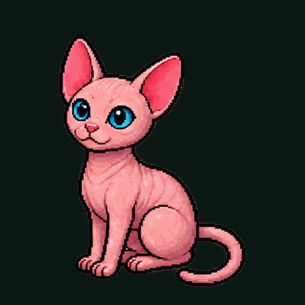

<p align="center">
  
</p>

<h1 align="center">PROCASTIA · Launcher para Fire TV</h1>

<p align="center">
  Tu propio menú de inicio para el Amazon Fire TV Stick, sin anuncios,<br>
  con un control remoto en tu iPhone cuyo botón <b>HOME</b> te lleva a <b>tu</b> menú.
</p>

<p align="center">
  Hecho con IA en el canal <b>PROCASTIA</b>: <i>"Hoy voy a crear algo que ayer no sabía."</i>
</p>

---

## Qué hace

| | |
|---|---|
| 🖥️ **Menú propio** | Pantalla de inicio en pixel art (verde y dorado), reloj, saludo, "misión del día" y Sirio, el gato |
| 📺 **Tus apps** | YouTube, Netflix, Prime Video, Spotify, Disney+ y la lista de todo lo instalado |
| 🏠 **Botón Home** | Si aparece el Home de Amazon, el menú PROCASTIA se abre encima |
| 📱 **Control en el iPhone** | Una página web servida *desde el propio Fire TV* que guardas como app. Su HOME abre tu menú directo |
| 💻 **Control desde PC** (opcional) | Script de Python que manda cualquier tecla por ADB |

> **Probado en:** Fire TV Stick 3.ª generación (modelo S3L46N), Fire OS 7.7.1.7.

## Cómo funciona (en corto)

```
iPhone (Safari)  ──HTTP :8765──▶  Fire TV: app PROCASTIA
                                    ├─ Menú (WebView con index.html)
                                    ├─ Servidor web (control remoto)
                                    └─ Vigilante del Home de Amazon
PC (Windows)  ──ADB por Wi‑Fi──▶  Fire TV  (para instalar la app)
```

- **Fire OS es Android**, así que podemos instalar nuestra propia app (APK) por **ADB**.
- Amazon **bloquea** cambiar el launcher por defecto (desde Fire OS 7.2.7.3). En vez de pelear con eso:
  1. la app vigila qué app está al frente y, si es el Home de Amazon, abre el menú PROCASTIA;
  2. el control del iPhone es **nuestro**, así que su botón HOME nunca va al Home de Amazon.

## Inicio rápido

**Necesitas:** PC con Windows, [Android Studio](https://developer.android.com/studio) y un Fire TV en la misma red Wi‑Fi.

1. **En el Fire TV:** Configuración → Mi Fire TV → Acerca de → presiona 7 veces el nombre del dispositivo → Opciones de desarrollador → activa **Depuración ADB**. Anota la IP (Acerca de → Red).
2. **Clona el repo** y abre la carpeta `launcher/` una vez en Android Studio para que descargue el SDK.
3. **Compila e instala** (PowerShell, desde la raíz del repo):
   ```powershell
   .\scripts\instalar.ps1 -FireTvIp 192.168.1.50
   ```
   Acepta en la tele el aviso **"Permitir depuración"**.
4. **En tu iPhone:** abre `http://IP-DE-TU-FIRE-TV:8765` en Safari → **Compartir → Agregar a pantalla de inicio**.

¿Primera vez con ADB o Android Studio? Sigue la **[guía paso a paso](docs/GUIA-PASO-A-PASO.md)**. Incluye todos los errores que nos salieron y cómo se resolvieron.

## Personalízalo

Todo está al inicio de [`launcher/app/src/main/assets/index.html`](launcher/app/src/main/assets/index.html):

```js
var USER_NAME = 'Max';                        // tu nombre
var MISSION   = 'Grabar el video del Fire TV'; // misión del día
var APPS = [ {name:'YouTube', pkg:'com.amazon.firetv.youtube'}, ... ];
var CHANNEL_URL = '...';                      // tu canal
```

Cambia a Sirio por tu propio personaje reemplazando `sirio.png` e `icon.png`.

> [!TIP]
> **🎨 Aquí es donde Claude te ayuda a diseñar TU menú.**
> Pásale a Claude tus colores, tu logo, tu personaje o cualquier archivo gráfico, y pídele que rediseñe `index.html` con tu estilo: otra paleta, otra tipografía, más filas de apps, un fondo animado… Nosotros lo hicimos así: primero diseñamos el menú con Claude y luego lo convertimos en la app. Tienes el prompt listo en [`docs/PROMPTS.md`](docs/PROMPTS.md#3-diseña-tu-menú).

### Diseña tu propio control

El control del iPhone es solo [`remote.html`](launcher/app/src/main/assets/remote.html): botones que llaman a `/k?b=home`, `/k?b=up`, `/k?b=app&pkg=...`.

> [!TIP]
> **📱 Aquí también puedes coordinar a Claude para que diseñes tu propio control.**
> Dile cómo lo imaginas: un control retro, uno minimalista, uno con los íconos de tus apps favoritas, botones grandes para tus papás… Claude te reescribe `remote.html` con tu diseño y te dice qué botones agregar en `RemoteServer.java` si quieres funciones nuevas. Prompt en [`docs/PROMPTS.md`](docs/PROMPTS.md#5-diseña-tu-control).

## Estructura

```
launcher/                 Proyecto de Android Studio (la app del Fire TV)
  app/src/main/assets/
    index.html            El menú (HTML + JS)
    remote.html           El control remoto para el iPhone
  app/src/main/java/...
    MainActivity.java     Muestra el menú y abre apps
    HomeWatcherService    Detecta el Home de Amazon y abre tu menú
    RemoteServer.java     Servidor web del control (puerto 8765)
    BootReceiver.java     Abre el menú al encender
pc-remote/control.py      Control alterno desde la PC (Python + ADB)
scripts/instalar.ps1      Compila e instala con un comando
docs/                     Guía paso a paso y prompts
```

## Limitaciones honestas

- Al presionar Home en el control de Amazon, se ve **medio segundo** el Home de Amazon antes del tuyo. Sin root no se puede evitar.
- El control del iPhone mueve **tu menú**. Dentro de otras apps (YouTube, etc.) sigue usando el control de Amazon: Android no deja que una app normal "presione teclas" en otras.
- Amazon puede cambiar Fire OS con una actualización y romper el truco del Home.

## Hazlo tú con IA

En [`docs/PROMPTS.md`](docs/PROMPTS.md) están los prompts que usamos, paso por paso, para que lo recrees o lo adaptes con Claude, ChatGPT o la IA que uses.

---

<p align="center">
  Código bajo licencia MIT · La marca PROCASTIA y Sirio son de Maximiliano Jiménez<br>
  <b>Si lo haces, cuéntanos en YouTube: PROCASTIA</b>
</p>
